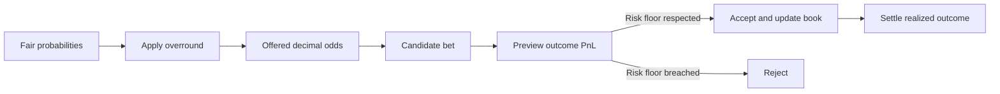

# Pricing, Overround, and Bookmaker Risk

## 1. What this model represents

Bookie is not a prediction oracle. It models a small fixed-odds bookmaker:

1. Start with fair probabilities.
2. Turn them into offered odds with an overround.
3. Track accepted stakes and the resulting liability.
4. Calculate bookmaker PnL for every possible outcome.
5. Accept a new bet only if it does not breach the configured risk floor.
6. Settle the book deterministically after an actual or simulated result.

All monetary terms in this document refer exclusively to fictional play
points.

## 2. Terminology

| Term | Meaning in this project |
| --- | --- |
| Fair probability \(p_i\) | Modeled probability of outcome \(i\) before margin |
| Fair odds | \(1/p_i\) |
| Implied probability \(q_i\) | Probability recovered from offered odds: \(1/O_i\) |
| Offered odds \(O_i\) | Decimal odds locked in when a bet is accepted |
| Stake | Points risked by the player |
| Payout | On a win: stake multiplied by odds, including the returned stake |
| Liability | Bookmaker's net obligation on a winning bet: stake multiplied by \((O_i-1)\) |
| PnL | Net profit or loss; player and bookmaker PnL are opposites |
| Risk floor | Lowest allowed bookmaker PnL across all outcomes after a new bet |

## 3. From fair probabilities to overround

Fair probabilities are first normalized to one:

$$
\sum_i p_i = 1.
$$

For a proportionally distributed margin \(m\), the engine calculates:

$$
q_i = (1+m)p_i
$$

and converts these values to decimal odds:

$$
O_i = \frac{1}{q_i} = \frac{1}{(1+m)p_i}.
$$

The overround is the sum of the probabilities implied by the offered odds:

$$
\Omega = \sum_i \frac{1}{O_i} = \sum_i q_i = 1+m.
$$

With \(m=5\%\), the overround is \(105\%\). Offered odds are therefore lower
than fair odds.

### Example: stay or leave

Assume the fair probabilities are:

- Stay: \(p_S=60\%\)
- Leave: \(p_L=40\%\)
- Proportional margin: \(m=5\%\)

| Outcome | Fair \(p_i\) | Fair odds \(1/p_i\) | Implied \(q_i\) | Offered odds \(1/q_i\) |
| --- | ---: | ---: | ---: | ---: |
| Stay | 60.00% | 1.6667 | 63.00% | 1.5873 |
| Leave | 40.00% | 2.5000 | 42.00% | 2.3810 |
| **Total** | **100.00%** | — | **105.00%** | — |

The Streamlit chart named “Fair vs. Offered” visualizes this difference.

### Implementation detail: minimum odds

`probs_to_odds()` clamps odds to at least `1.01` by default. At extreme
probabilities, this can cause the overround recovered from final odds to differ
from exactly \(1+m\). The clamp does not activate within the normal range of
the career demo.

## 4. Overround is not realized profit

An overround of 105% does not mean that the bookmaker is guaranteed to earn
5%. Under the simplifying assumptions of this model, a single stake \(s\) has
the following expected bookmaker PnL:

$$
E[\mathrm{PnL}_{Bookmaker}]
=s\left(1-p_iO_i\right)
=s\left(1-\frac{1}{1+m}\right)
=s\frac{m}{1+m}.
$$

For \(m=5\%\), this is:

$$
\frac{0.05}{1.05}=4.7619\%.
$$

Under these assumptions, the theoretical expected bookmaker return is about
4.76% of the stake, not 5%. The corresponding theoretical player return is:

$$
\mathrm{RTP}=\frac{1}{1+m}=95.2381\%.
$$

This calculation assumes that:

- fair probabilities are correctly calibrated;
- offered odds use the proportional scaling above;
- rounding and minimum-odds effects do not apply;
- correlated or dependent markets are not combined.

The **realized** profit on one market may be strongly positive or negative.
Expected value describes many comparable repetitions, not the next individual
outcome.

## 5. Why bookmakers do not need to predict the future

The central idea is:

> The bookmaker does not need to know which outcome will happen next. It needs
> to price the distribution well enough and ensure that it can financially
> survive every possible outcome.

This model uses four separate mechanisms to achieve that goal.

### 5.1 Probabilities instead of certainty

A fair probability of 60% does not mean “stay will happen.” It means that the
outcome should occur in roughly 60% of a large set of sufficiently comparable
cases. Any individual realization can still be the 40% outcome.

### 5.2 A pricing edge from overround

When probabilities are calibrated, overround moves expected value in favor of
the bookmaker. It turns uncertainty into positive mathematical expectation,
but not guaranteed profit.

### 5.3 Outcome-conditioned PnL instead of a single forecast

Before settlement, `RiskBook.worst_case_pnl()` calculates PnL for **every**
possible outcome:

$$
\mathrm{PnL}(i)
=\text{stakes on losing outcomes}
-\text{liability on outcome }i.
$$

The bookmaker therefore sees not only what it considers likely, but also what
happens financially in every scenario.

### 5.4 Acceptance and rejection as risk policy

`check_bet()` copies the current book, adds the candidate bet only to that
copy, and calculates the new PnL surface. The rule is:

$$
\text{accept}
\iff
\min_i \mathrm{PnL}_{after\ bet}(i)
\geq \text{risk floor}.
$$

A bet may therefore be rejected despite an attractive margin if it creates too
much exposure in one outcome. That is why risk management is different from
outcome prediction.

Each `AcceptDecision` records the projected worst-case PnL and the applicable
risk floor. Its reason explains whether the projection meets or breaches that
floor; the interface does not use an unexplained generic success status.

## 6. Worked book example

Use the odds from the 60/40 example and a risk floor of `-20` points.

### First bet

- 25 points on stay at odds of 1.5873
- Liability if stay occurs: \(25(1.5873-1)=14.68\)

| Scenario | Bookmaker PnL |
| --- | ---: |
| Stay | -14.68 |
| Leave | +25.00 |

The bookmaker does not need to rule out stay. It only needs to decide whether
the possible loss of 14.68 points fits within its risk floor.

### Second bet

Add 25 points on leave at odds of 2.3810.

| Scenario | Calculation | Bookmaker PnL |
| --- | --- | ---: |
| Stay | 25.00 losing leave stake minus 14.68 liability | +10.32 |
| Leave | 25.00 losing stay stake minus 34.52 liability | -9.52 |

The worst case improves to about `-9.52` points. The probability-weighted
expected PnL of the complete book is:

$$
0.60(10.32)+0.40(-9.52)\approx 2.38.
$$

The book is not profitable in every outcome, but expected PnL is positive and
the possible loss remains inside the selected limit.

### Sequence dependence of the current policy

With a stricter risk floor of `-10` points, the **first** bet would be rejected
because its worst case is `-14.68`. A later opposing bet could balance the
book, but it is not known when the first decision is made. The current policy
is therefore intentionally sequential and conservative. A future extension
could model reserved liquidity, hedge orders, or exposure-aware requoting.

## 7. Reading the dashboard

| View | Interpretation |
| --- | --- |
| Fair vs. Offered | Price reduction caused by proportional overround |
| Net Liability | Net obligation if the respective outcome wins |
| Outcome-conditioned PnL | Bookmaker result for each possible realization |
| Risk-floor line | Lower bound that a new bet may not breach |
| Exposure distribution | Distribution of accepted stakes across outcomes |
| Expected bookmaker PnL | Scenario PnL weighted by fair probabilities |
| Acceptance/rejection feed | Sequence of evaluated requests and decisions |

PnL is always shown from the bookmaker's perspective: positive values are
bookmaker profit and negative values are bookmaker loss. Before settlement,
the highlighted value is an expectation. After settlement, the interface
separately highlights the realized bookmaker result.

Every view is recalculated from the same `RiskBook` after each manual or
simulated request. They are different perspectives on one shared state, not
independent metrics.

## 8. Common misconceptions

### “A 105% overround means 5% guaranteed profit.”

No. Overround is initially a property of offered odds. Profit depends on model
assumptions, realized stakes, and realized outcomes.

### “The bookmaker must predict more winners than the players.”

Not necessarily. The bookmaker sells odds and manages liability. Pricing
quality, margin, stake distribution, and risk limits matter more than a series
of binary predictions.

### “Liability is the total payout.”

No. In this engine, liability is the net obligation `stake * (odds - 1)`. The
gross payout to a winning player is `stake * odds`.

### “Expected PnL is the PnL that will occur.”

No. Expected PnL is a probability-weighted average. After settlement, exactly
one of the outcome-conditioned PnL values is realized.

### “The risk floor prevents every loss.”

Only a risk floor of at least zero excludes negative scenario PnL within the
modeled market. A negative floor deliberately permits bounded losses. It also
cannot protect against incorrect model assumptions or omitted risks.

## 9. Current model limitations

- Fair probabilities are supplied externally.
- There is no capital or bankroll account across markets.
- Markets and matches are not correlated.
- Prices are not dynamically updated from current exposure.
- The Streamlit demo stores state only in memory.
- There are no real accounts, payments, or real-money bets.

These limitations matter. Overround and a risk floor do not replace a good
probability model or capital management. They do make it transparent why a
bookmaker system can operate systematically without certain knowledge of the
next outcome.

## 10. Mapping concepts to code

| Concept | Implementation |
| --- | --- |
| Overround and odds | `src/bookie/engine/pricing.py` |
| Stakes, liability, and scenario PnL | `src/bookie/engine/risk.py` |
| Acceptance policy | `src/bookie/engine/accept.py` |
| Realized settlement | `src/bookie/engine/settlement.py` |
| Career market and expected PnL | `src/bookie/career.py` |
| Plotly visualizations | `src/bookie/dashboard.py` |
| Interactive demo | `src/bookie/web.py` |

The mathematical core remains independent of Streamlit and Plotly. The UI
reads and visualizes engine state; it does not define separate pricing or risk
rules.
