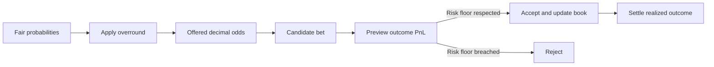

# Pricing, Overround und Bookmaker-Risiko

## 1. Worum es in diesem Modell geht

Bookie ist kein Vorhersageautomat. Die Engine bildet einen kleinen
Fixed-Odds-Bookmaker ab:

1. Sie beginnt mit fairen Wahrscheinlichkeiten.
2. Sie berechnet daraus angebotene Quoten mit Overround.
3. Sie speichert Einsätze und die daraus entstehende Liability.
4. Sie berechnet den Bookie-PnL für jedes mögliche Ergebnis.
5. Sie nimmt eine neue Wette nur an, wenn der konfigurierte Risk Floor nicht
   unterschritten wird.
6. Nach dem tatsächlichen oder simulierten Ergebnis wird der Book
   deterministisch abgerechnet.

Alle Geldbegriffe in dieser Dokumentation bezeichnen ausschließlich fiktive
Spielpunkte.

## 2. Begriffe

| Begriff | Bedeutung im Projekt |
| --- | --- |
| Faire Wahrscheinlichkeit \(p_i\) | Modellierte Wahrscheinlichkeit des Outcomes \(i\) vor Marge |
| Faire Quote | \(1/p_i\) |
| Implied Probability \(q_i\) | Aus der angebotenen Quote abgeleitete Wahrscheinlichkeit \(1/O_i\) |
| Angebotene Quote \(O_i\) | Beim Abschluss festgeschriebene Dezimalquote |
| Einsatz | Vom Spieler riskierte Punkte |
| Auszahlung | Bei Gewinn: Einsatz mal Quote, einschließlich Rückgabe des Einsatzes |
| Liability | Nettoverpflichtung des Bookies bei Gewinn der Wette: Einsatz mal \((O_i-1)\) |
| PnL | Nettogewinn oder -verlust; Spieler- und Bookie-PnL sind gegensätzlich |
| Risk Floor | Kleinster erlaubter Bookie-PnL über alle Outcomes nach einer neuen Wette |

## 3. Von fairen Wahrscheinlichkeiten zum Overround

Die fairen Wahrscheinlichkeiten werden zunächst auf eins normiert:

$$
\sum_i p_i = 1.
$$

Bei einer proportional verteilten Marge \(m\) verwendet die Engine:

$$
q_i = (1+m)p_i
$$

und wandelt diese Werte in Dezimalquoten um:

$$
O_i = \frac{1}{q_i} = \frac{1}{(1+m)p_i}.
$$

Der Overround ist die Summe der aus den angebotenen Quoten abgeleiteten
Wahrscheinlichkeiten:

$$
\Omega = \sum_i \frac{1}{O_i} = \sum_i q_i = 1+m.
$$

Bei \(m=5\%\) ergibt sich also ein Overround von \(105\%\). Die angebotenen
Quoten sind niedriger als die fairen Quoten.

### Beispiel: Verbleib oder Wechsel

Angenommen, die fairen Wahrscheinlichkeiten lauten:

- Verbleib: \(p_V=60\%\)
- Wechsel: \(p_W=40\%\)
- proportionale Marge: \(m=5\%\)

| Outcome | Fair \(p_i\) | Faire Quote \(1/p_i\) | Implied \(q_i\) | Angebotene Quote \(1/q_i\) |
| --- | ---: | ---: | ---: | ---: |
| Verbleib | 60,00 % | 1,6667 | 63,00 % | 1,5873 |
| Wechsel | 40,00 % | 2,5000 | 42,00 % | 2,3810 |
| **Summe** | **100,00 %** | — | **105,00 %** | — |

Die Streamlit-Grafik „Fair vs. Offered“ visualisiert genau diesen Unterschied.

### Implementierungsdetail: Mindestquote

`probs_to_odds()` begrenzt Quoten standardmäßig auf mindestens `1.01`. Bei
extremen Wahrscheinlichkeiten kann dieses Clamping dazu führen, dass der aus
den finalen Quoten zurückgerechnete Overround nicht mehr exakt \(1+m\) ist.
Im normalen Wertebereich des Career-Demos greift diese Grenze nicht.

## 4. Overround ist nicht dasselbe wie realisierter Gewinn

Ein Overround von 105 % bedeutet nicht, dass der Bookie sicher 5 % verdient.
Unter den vereinfachenden Annahmen dieses Modells gilt für einen einzelnen
Einsatz \(s\):

$$
E[\mathrm{PnL}_{Bookie}]
=s\left(1-p_iO_i\right)
=s\left(1-\frac{1}{1+m}\right)
=s\frac{m}{1+m}.
$$

Bei \(m=5\%\) entspricht das:

$$
\frac{0{,}05}{1{,}05}=4{,}7619\%.
$$

Der theoretische erwartete Bookie-Ertrag beträgt unter diesen Annahmen also
rund 4,76 % des Einsatzes, nicht 5 %. Der korrespondierende theoretische
Spieler-Return ist:

$$
\mathrm{RTP}=\frac{1}{1+m}=95{,}2381\%.
$$

Diese Rechnung setzt insbesondere voraus:

- die fairen Wahrscheinlichkeiten sind korrekt kalibriert,
- die angebotene Quote entsteht durch die proportionale Skalierung oben,
- es gibt keine Rundungs- oder Mindestquoteneffekte,
- es werden keine korrelierten oder voneinander abhängigen Märkte vermischt.

Der **realisierte** Gewinn kann bei einem einzelnen Markt deutlich positiv
oder negativ sein. Der Erwartungswert ist eine Aussage über viele vergleichbare
Wiederholungen, nicht über das nächste konkrete Outcome.

## 5. Warum Buchmacher keine Hellseher sein müssen

Die zentrale Aussage lautet:

> Der Bookie muss nicht wissen, welches Outcome als Nächstes eintritt. Er muss
> die Verteilung hinreichend gut bepreisen und sicherstellen, dass er jedes
> mögliche Outcome finanziell überstehen kann.

Das funktioniert in diesem Modell über vier getrennte Mechanismen.

### 5.1 Wahrscheinlichkeiten statt Gewissheit

Eine faire Wahrscheinlichkeit von 60 % bedeutet nicht „Verbleib wird
eintreten“. Sie bedeutet: In einer großen Menge hinreichend vergleichbarer
Situationen sollte dieses Outcome ungefähr in 60 % der Fälle auftreten. Eine
einzelne Realisierung kann jederzeit das 40-%-Outcome sein.

### 5.2 Preisvorteil durch Overround

Wenn die Wahrscheinlichkeiten kalibriert sind, verschiebt der Overround den
Erwartungswert zugunsten des Bookies. Er macht aus Unsicherheit einen positiven
mathematischen Erwartungswert — aber noch keinen garantierten Gewinn.

### 5.3 Outcome-conditioned PnL statt bloßer Prognose

`RiskBook.worst_case_pnl()` berechnet vor dem Settlement den PnL für **jedes**
mögliche Outcome:

$$
\mathrm{PnL}(i)
=\text{Einsätze auf verlierende Outcomes}
-\text{Liability auf Outcome }i.
$$

Der Bookie sieht damit nicht nur, was er für wahrscheinlich hält, sondern was
in jedem Szenario finanziell passiert.

### 5.4 Annahme oder Ablehnung als Risikopolitik

`check_bet()` kopiert den aktuellen Book, fügt die Kandidatenwette nur in der
Kopie hinzu und berechnet die neue PnL-Oberfläche. Es gilt:

$$
\text{accept}
\iff
\min_i \mathrm{PnL}_{nach\ Wette}(i)
\geq \text{Risk Floor}.
$$

Eine Wette kann also trotz attraktiver Marge abgelehnt werden, wenn sie den
Book in einem Outcome zu stark belastet. Genau deshalb ist Risikosteuerung
nicht dasselbe wie Ergebnisvorhersage.

## 6. Durchgerechnetes Book-Beispiel

Wir verwenden die Quoten aus dem 60/40-Beispiel und einen Risk Floor von
`-20` Punkten.

### Erste Wette

- 25 Punkte auf Verbleib zu Quote 1,5873
- Liability bei Verbleib: \(25(1{,}5873-1)=14{,}68\)

| Szenario | Bookie-PnL |
| --- | ---: |
| Verbleib | -14,68 |
| Wechsel | +25,00 |

Der Bookie muss Verbleib nicht ausschließen. Er muss lediglich entscheiden, ob
der mögliche Verlust von 14,68 Punkten innerhalb seines Risk Floors liegt.

### Zweite Wette

Nun kommen zusätzlich 25 Punkte auf Wechsel zu Quote 2,3810 hinzu.

| Szenario | Rechnung | Bookie-PnL |
| --- | --- | ---: |
| Verbleib | 25,00 verlierender Wechsel-Einsatz minus 14,68 Liability | +10,32 |
| Wechsel | 25,00 verlierender Verbleib-Einsatz minus 34,52 Liability | -9,52 |

Der Worst Case verbessert sich auf rund `-9,52` Punkte. Der
wahrscheinlichkeitsgewichtete erwartete PnL des gesamten Books beträgt:

$$
0{,}60(10{,}32)+0{,}40(-9{,}52)\approx 2{,}38.
$$

Der Book ist nicht in jedem Outcome profitabel, aber sein erwarteter PnL ist
positiv und sein möglicher Verlust bleibt innerhalb des gewählten Limits.

### Sequenzabhängigkeit der aktuellen Policy

Mit einem strengeren Risk Floor von `-10` Punkten würde die **erste** Wette
abgelehnt, weil ihr Worst Case `-14,68` beträgt. Die spätere Gegenwette könnte
den Book zwar ausbalancieren, ist bei der ersten Entscheidung aber noch nicht
bekannt. Die aktuelle Policy ist deshalb bewusst sequenziell und konservativ.
Ein späterer Ausbau könnte reservierte Liquidität, Hedge-Aufträge oder
Exposure-aware Requoting modellieren.

## 7. Was die Dashboard-Ansichten bedeuten

| Ansicht | Interpretation |
| --- | --- |
| Fair vs. Offered | Preisabschlag durch den proportionalen Overround |
| Net Liability | Nettoverpflichtung, falls das jeweilige Outcome gewinnt |
| Outcome-conditioned PnL | Bookie-Ergebnis für jede mögliche Realisierung |
| Risk-Floor-Linie | Untergrenze, die eine neue Wette nicht verletzen darf |
| Exposure-Verteilung | Verteilung der angenommenen Einsätze auf die Outcomes |
| Expected Bookie PnL | Mit fairen Wahrscheinlichkeiten gewichteter Szenario-PnL |
| Acceptance/Rejection Feed | Sequenz der geprüften Wettanfragen und Entscheidungen |

Die Ansichten werden nach jeder manuellen oder simulierten Wettanfrage aus
demselben `RiskBook` neu berechnet. Sie sind verschiedene Perspektiven auf
denselben Zustand, keine voneinander unabhängigen Kennzahlen.

## 8. Häufige Missverständnisse

### „105 % Overround bedeutet 5 % sicheren Gewinn.“

Nein. Overround ist zunächst eine Eigenschaft der angebotenen Quoten. Gewinn
entsteht nur unter Modellannahmen und über realisierte Einsätze und Outcomes.

### „Der Bookie muss häufiger richtig liegen als die Spieler.“

Nicht zwingend. Der Bookie verkauft Quoten und steuert Liability. Entscheidend
sind Preisqualität, Marge, Einsatzverteilung und Risikolimits — nicht eine
Serie binärer Tipps.

### „Liability ist die gesamte Auszahlung.“

Nein. In dieser Engine ist Liability die Nettoverpflichtung
`stake * (odds - 1)`. Die Bruttoauszahlung an den Gewinner ist `stake * odds`.

### „Expected PnL ist der PnL, der eintreten wird.“

Nein. Expected PnL ist ein wahrscheinlichkeitsgewichteter Mittelwert. Nach dem
Settlement tritt genau einer der outcome-conditioned PnL-Werte ein.

### „Der Risk Floor verhindert jeden Verlust.“

Nur ein Risk Floor von mindestens null würde negative Szenario-PnLs im
modellierten Markt ausschließen. Ein negativer Floor erlaubt bewusst begrenzte
Verluste. Außerdem schützt er nicht vor falschen Modellannahmen oder Risiken,
die im Marktmodell fehlen.

## 9. Grenzen des aktuellen Modells

- Die fairen Wahrscheinlichkeiten werden von außen vorgegeben.
- Es gibt noch kein Kapital- oder Bankroll-Konto über mehrere Märkte.
- Märkte und Matches sind nicht korreliert.
- Es gibt keine dynamische Requotierung anhand des aktuellen Exposures.
- Die Streamlit-Demo hält ihren Zustand nur im Arbeitsspeicher.
- Es gibt keine echten Konten, Zahlungen oder Echtgeldwetten.

Diese Grenzen sind wichtig: Overround und Risk Floor ersetzen weder ein gutes
Wahrscheinlichkeitsmodell noch Kapitalmanagement. Sie machen aber transparent,
warum ein Bookmaker-System auch ohne sichere Kenntnis des nächsten Outcomes
systematisch arbeiten kann.

## 10. Zuordnung zum Code

| Konzept | Implementierung |
| --- | --- |
| Overround und Quoten | `src/bookie/engine/pricing.py` |
| Stakes, Liability und Szenario-PnL | `src/bookie/engine/risk.py` |
| Acceptance Policy | `src/bookie/engine/accept.py` |
| Realisiertes Settlement | `src/bookie/engine/settlement.py` |
| Career-Markt und Expected PnL | `src/bookie/career.py` |
| Plotly-Visualisierungen | `src/bookie/dashboard.py` |
| Interaktive Demo | `src/bookie/web.py` |

Der mathematische Kern bleibt unabhängig von Streamlit und Plotly. Die UI liest
seinen Zustand und visualisiert ihn; sie definiert keine eigenen Pricing- oder
Risk-Regeln.
